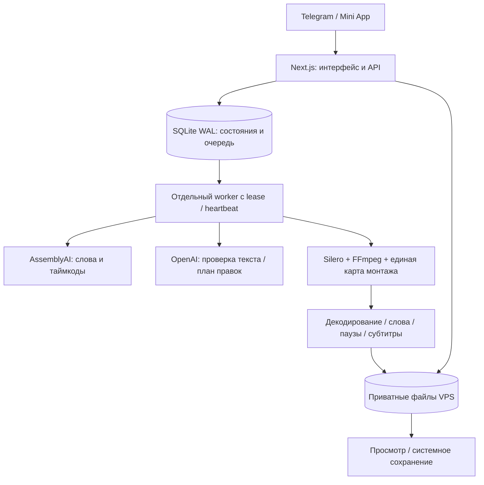

# Speechcut — монтаж речи в Telegram

Telegram Mini App, в котором видео монтируется по тексту: загрузите запись, удалите лишние слова из сценария, подтвердите правки и получите MP4 с субтитрами и сокращёнными паузами.

Это исходный код самостоятельного приложения для установки **на свой VPS, со своим ботом и API-ключами**. Репозиторий публичный; доступ к установленному приложению по умолчанию ограничен Telegram ID владельца.

## Установить с помощью ChatGPT

Скопируйте в новый чат вместе со ссылкой на этот репозиторий:

```text
Помоги установить приложение из https://github.com/Daniil33-dev/speechcut-telegram-miniapp
Прочитай README.md, AGENTS.md, docs/INSTALL.md и prompts/MASTER_PROMPT_RU.md.
Используй готовый код репозитория и исправления, не переписывай приложение с нуля.
Проверь доступные инструменты и спроси только недостающие данные.
Мне нужен собственный Telegram-бот на моём VPS с OpenAI и AssemblyAI.
Не проси присылать ключи, пароли или содержимое SSH-ключа в чат.
Проведи меня до рабочего HTTPS Mini App, проверенного ролика и сохранения файла.
Если у тебя нет терминала или доступа к серверу, давай конкретные команды
для меня и проверяй результаты; не утверждай, что выполнил их самостоятельно.
```

Одна ссылка даёт ChatGPT доступ к инструкции и коду, но не доступ к вашим аккаунтам. Для самостоятельного выполнения команд нужен агент с терминалом и разрешённый SSH-доступ; обычный чат может вести вас по шагам.

**[Пошаговая установка →](docs/INSTALL.md)** · **[Полный мастер-промпт →](prompts/MASTER_PROMPT_RU.md)** · **[Что исправлено →](docs/FIXES.md)**

## Возможности

- Русская расшифровка с таймкодами слов и проверкой текста через OpenAI.
- Ручное удаление слов удаляет соответствующий звук и видео; исправление написания меняет субтитры.
- ИИ сокращает повторы и переносит существующую фразу в начало. Новая версия показывается до сборки.
- Версии, черновики, одобрение конкретного сценария, отмена и повтор операций.
- Паузы строго длиннее 300 мс сокращаются после акустической проверки; тихие слова и окончания защищены.
- Субтитры до двух строк с измеренными боковыми полями 10%; регулируемая высота.
- H.264/AAC MP4, сохранение ориентации и пропорций, обработка iPhone HDR → SDR.
- Загрузка до 500 МиБ / 15 минут тремя параллельными потоками с реальным прогрессом.
- На телефоне: «Подготовить сохранение» → системное меню. На компьютере: «Скачать видео» → штатный загрузчик Telegram, обычно в «Загрузки».
- Приватные исходники, подписанные ссылки, расходы API по каждому ролику.

## Схема



## Что потребуется

| Компонент | Назначение |
| --- | --- |
| Ubuntu 24.04 VPS, ориентир 4 vCPU / 8 ГБ RAM | Web, worker, FFmpeg, приватное хранилище |
| Домен с DNS на VPS, HTTPS через Caddy | Адрес Mini App и Telegram webhook |
| Новый бот через [BotFather](https://t.me/BotFather) | Открытие Mini App и уведомления |
| [AssemblyAI](https://www.assemblyai.com/) API | Распознавание с таймкодами слов |
| [OpenAI Platform](https://platform.openai.com/) API | Проверка текста и ИИ-монтаж |
| Node.js 24, pnpm 11.25.0, FFmpeg с libass/zscale | Зафиксированная среда исполнения |

Подписка ChatGPT и API-баланс оплачиваются отдельно. Сервер, API и трафик могут стоить денег; неизвестный тариф показывается как неизвестный. Модель OpenAI выбирается из доступных в вашем API-проекте и проверяется на Structured Outputs + reasoning low. Имя модели не подставляется за пользователя.

## Разработка

```sh
pnpm install --frozen-lockfile
pnpm run setup:env
# Заполните .env.local в редакторе; для интерфейса вне Telegram:
# DEV_AUTH_ENABLED=true (только локально, вне production).
pnpm run setup:media
pnpm run db:migrate
pnpm run doctor -- --offline
pnpm run dev
```

В другом терминале запустите `pnpm run worker`. Web слушает `http://127.0.0.1:3048`. Настоящие ASR/LLM требуют своих ключей; подставных ответов провайдеров нет. FFmpeg на macOS может не содержать нужные фильтры — `doctor` проверяет их, медиаоперации можно выполнять на Ubuntu.

```sh
pnpm run check
pnpm test
pnpm run test:media
pnpm run doctor -- --offline
pnpm run build
pnpm run audit:public
```

Обычные тесты и `test:media` не вызывают платные API. `verify-asr.ts` — отдельная платная интеграционная проверка только по явному решению владельца.

## Файлы и инструкции

| Путь | Содержимое |
| --- | --- |
| [docs/INSTALL.md](docs/INSTALL.md) | Установка от пустого VPS до бота |
| [prompts/MASTER_PROMPT_RU.md](prompts/MASTER_PROMPT_RU.md) | Полное ТЗ и инструкции агенту с учётом исправлений |
| [docs/ARCHITECTURE.md](docs/ARCHITECTURE.md) | Слои, данные, очередь, карта монтажа |
| [docs/CONFIGURATION.md](docs/CONFIGURATION.md) | Все переменные окружения |
| [docs/USER_GUIDE.md](docs/USER_GUIDE.md) | Работа с роликами и сохранение |
| [docs/FIXES.md](docs/FIXES.md) | Ошибки, причины, исправления и регрессии |
| [docs/TROUBLESHOOTING.md](docs/TROUBLESHOOTING.md) | Диагностика без потери исходников |
| [docs/API.md](docs/API.md) | Фактический API и правила доступа |
| [deploy/VPS.md](deploy/VPS.md) | Обновление, откат, backup/restore |
| [ACCEPTANCE.md](ACCEPTANCE.md) | Реальные проверки и их границы |
| [SECURITY.md](SECURITY.md) | Секреты, приватность и ограничения личного режима |
| [AGENTS.md](AGENTS.md) | Инварианты для дальнейшей работы агента |

## Ограничения

Это личный редактор с allowlist, а не готовый публичный SaaS. Один worker выполняет одну операцию за раз. Скорость зависит от сети, процессора и API; улучшение передачи не гарантирует одинаковую скорость на всех устройствах. Шумная речь может потребовать ручной проверки; QA останавливает сомнительный экспорт.

Сохранение в «Фото» требует выбора пользователя. Нативный загрузчик доступен в поддерживающих его клиентах Telegram 8.0+; папку назначения задают настройки клиента. Android и Windows требуют отдельной проверки на устройстве. Для Web Share файл подготавливается в памяти только до 48 МиБ; большие результаты передаются штатному загрузчику.

Исходники и результаты хранятся до ручного удаления, квота по умолчанию 10 ГиБ на владельца. Backup БД содержит текст, но не видео; копия на том же диске не заменяет оффсайт. При сбое удаления transcript у AssemblyAI нужен отдельный повтор — подробности в SECURITY.md.

Лицензия кода: [MIT](LICENSE). Лицензии шрифта и модели: [THIRD_PARTY_NOTICES.md](THIRD_PARTY_NOTICES.md).
