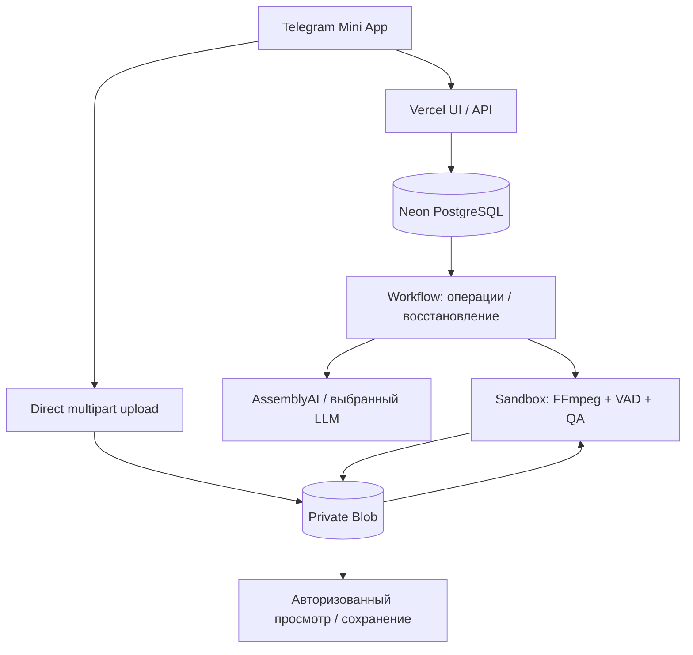

# Альтернативная ветка: Vercel без собственного VPS

**Статус: проектная схема и последовательность адаптации. Текущие SQLite store, файловое хранилище и systemd worker не являются готовой Vercel-реализацией. Обычный Import Git Repository → Deploy не завершает эту миграцию.**

## Состав и схема

| Часть | Предлагаемая роль |
| --- | --- |
| Vercel / Next.js | UI, авторизованный API, webhook, выдача ограниченных ссылок |
| Private Vercel Blob | Исходники, готовые MP4 и диагностические артефакты |
| Neon PostgreSQL | Jobs, версии, операции, ledger, ownership, ревизии |
| Vercel Workflow | Долговечные шаги, ожидание провайдеров, восстановление |
| Vercel Sandbox | Отдельное выполнение FFmpeg/FFprobe, шрифта и Silero |
| AssemblyAI + OpenAI либо OpenRouter | ASR и LLM; выбор LLM независим от хостинга |

Это инженерный план для данного приложения. Возможности платформы сверены 16 ноября 2026 года; тарифы и SDK перепроверяются при реализации.

## 1. Аккаунты и бюджет

Нужны свой Vercel project/team, доступ к private Blob, PostgreSQL (например Neon), Workflow/Sandbox, свой бот и API-провайдеры. Сначала проверьте доступность сервисов, подходящий план, регион, spend limits и квоты. Не подключайте одновременно VPS или платный тариф без выбора пользователя.

У Blob отдельно учитываются хранение и передача: включённый трафик не является дисковым пространством. На дату проверки в таблице Hobby — 1 GB/month storage и первые 10 GB transfer. [Текущая таблица и определения](https://vercel.com/docs/vercel-blob/usage-and-pricing).

У Sandbox отдельно считаются CPU, provisioned memory и другие ресурсы; Hobby включает 5 активных CPU-часов в месяц. Это суммарное CPU-время, а не пять часов готовых роликов. [Тарифы Sandbox](https://vercel.com/docs/sandbox/pricing).

У Workflow свои события и объём данных, выполнение шагов/доставка также используют ресурсы платформы. Поэтому бесплатные квоты отдельных сервисов не доказывают бесплатность всего монтажа. [Тарифы Workflow](https://vercel.com/docs/workflows/pricing).

## 2. Изолированная ветка адаптации

Создайте отдельную ветку/копию для Vercel. Сохраните src/core, правила редактора, render-инварианты и все исправления. Выделите контракты store, storage, queue и запуска медиа; не переписывайте UI и бизнес-логику без необходимости.

Выберите актуальные совместимые версии `@vercel/blob`, `@neondatabase/serverless`, `workflow`, `@vercel/sandbox`, зафиксируйте lockfile. При разработке Workflow читайте документацию установленного SDK в `node_modules/workflow/docs/` и [официальную интеграцию](https://vercel.com/docs/workflows); не угадывайте API по старым примерам.

## 3. PostgreSQL и очередь

Перенесите SQLite SQL и Store на PostgreSQL с транзакциями, параметрами, ownership, optimistic revision и уникальными ключами идемпотентности. Сохраните selected/approved version раздельно, неизменяемые artifact snapshots, usage и outbox. JSON-документ сам по себе не заменяет атомарные ограничения.

Не храните SQLite или пользовательские видео на локальном диске Function. Состояние не должно зависеть от памяти одного процесса. Подключение БД и миграции выполняйте с подходящим serverless connection/pool; регион согласуйте с API.

## 4. Direct upload и private Blob

Переработайте src/client/upload.ts и upload routes под прямую клиентскую multipart-загрузку: исходные 500 МиБ не проходят телом API Function. До выдачи client token проверьте Telegram initData, allowlist, owner/job, lease, размер и квоту. Ограничьте токен нужной загрузкой. [Client uploads](https://vercel.com/docs/vercel-blob/client-upload).

Используйте текущий multipart SDK, реальные байты прогресса, abort и повторы частей. Callback подтверждается документированным способом; перед привязкой повторно проверяются отмена, ownership, revision, полный размер и метаданные. Повтор callback/complete не создаёт второй ASR. [Multipart API](https://vercel.com/docs/vercel-blob/using-blob-sdk#multipart-uploads).

Private файлы не становятся публичными ради ASR: выдавайте ограниченный URL или передавайте извлечённое аудио. Восстановите HEAD/Range и разные preview/download-подписи с attachment/CORS для нативного сохранения. Не проксируйте весь MP4 в RAM Function. Механизм выдачи должен соответствовать [private Blob](https://vercel.com/docs/vercel-blob/using-blob-sdk).

## 5. Долговечная обработка и Sandbox

Workflow хранит небольшие ID/ссылки и результаты этапов, а не видео/PCM в истории. Внешние I/O, SDK и работа с Node вынесены в шаги; оркестрация использует поддерживаемые ожидания/повторы. Перед платным вызовом сохраняйте operation/request ID, после ответа — usage и checkpoint. Не обещайте exactly-once для неоднозначного сетевого сбоя.

Рендер выполняйте в отдельном Sandbox с подготовленной средой FFmpeg/шрифт/VAD. Не запускайте длинный FFmpeg внутри upload/webhook route. Укажите ресурсы и timeout по измерению, сохраните sandbox ID и checkpoint. В текущем [Sandbox](https://vercel.com/docs/sandbox) есть persistence/snapshots/drives; выберите нужный lifecycle явно. При этом опубликованный MP4 и состояние приложения должны оставаться доступны независимо от активной sandbox-сессии.

Скачайте private source, выполните единый edit-map, рендер и word/pause QA; загрузите проверенные артефакты в private Blob. Публикация транзакционно проверяет актуальность операции. Отмена инвалидирует поздний результат и останавливает вычисления. Повтор рендера использует прежний ASR/сценарий; rendererRevision и hash входят в checkpoint. Подготовленную среду переиспользуйте, ресурсы по завершении остановите/освободите согласно выбранному lifecycle.

## 6. Конфигурация и deployment

Образец будущих переменных — [vercel.env.example](vercel.env.example). Это не готовый env для неизменённого VPS-кода. Используйте секреты Vercel project/env и рекомендованную текущим SDK OIDC/identity-авторизацию для сервисов, где она поддерживается. Не создавайте долгоживущий VERCEL_TOKEN без реальной необходимости и не помещайте ключи в NEXT_PUBLIC_*.

Настройте production и preview раздельно. Production HTTPS URL должен быть доступен Telegram, webhook и нужным callback; preview может оставаться защищённым. Установите webhook/menu своего бота только после внешнего health. Не отключайте защиту всего аккаунта ради тестирования preview.

## 7. Приёмка до статуса «готово»

Проверить свои миграции/конкуренцию, доступ чужого пользователя, >40-МиБ direct upload, отмену/callback, restart/resume, лимит провайдера, точный approved snapshot и отсутствие повторных платных шагов. Затем настоящий MP4, слуховую/визуальную проверку, Range и сохранение на телефоне и компьютере. Все исправления [FIXES.md](../docs/FIXES.md) обязательны и здесь.

Отдельно измерьте upload/ASR/LLM/render/QA и расходы Blob/DB/Workflow/Sandbox. Завершение deploy со статусом READY недостаточно. Запишите собственную облачную приёмку; если адаптеров или проверок нет, не выдавайте ветку за работающую.
