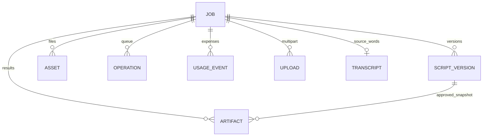

# Архитектура

Реализован один вариант: VPS + OpenAI + AssemblyAI. В этом репозитории нет адаптеров OpenRouter, Vercel Blob/Workflow/Sandbox или PostgreSQL. Для них потребуется отдельная разработка по [схеме альтернатив](ALTERNATIVES.md), [Vercel](../deploy/VERCEL.md) и [OpenRouter](OPENROUTER.md). Выбор из исходного мастер-промпта сохранён; статус реализации обозначен отдельно.

## Каталоги

```text
src/
  app/          Next.js: страницы, API, приватная выдача медиа
  components/   сценарий, субтитры, расходы, сохранение
  client/       multipart upload и платформенное сохранение
  core/         типы, Zod, версии сценария, ID слов, расчёт расходов
  config/       серверные инструкции корректору и монтажному LLM
  server/       auth, SQLite store, storage, services, Telegram, worker
    providers/  AssemblyAI и OpenAI Responses
  render/       акустика, edit-map, субтитры, FFmpeg, аудио-QA
migrations/     SQL, автоматически применяемый по версии
scripts/        настройка, миграции, doctor, очистка, диагностика
deploy/         Ubuntu bootstrap, релизы, systemd, Caddy, backup
tests/          domain/client/store + настоящий FFmpeg
prompts/        полный мастер-промпт для установки и сопровождения
```

Web проверяет Telegram initData и ownership, валидирует команду и сохраняет операцию. Worker захватывает её транзакционно, обновляет heartbeat и сохраняет checkpoints. Длинный FFmpeg не выполняется в HTTP-запросе. После полной загрузки закрытие Mini App не останавливает обработку.

## Данные и состояния



Физическая схема — [001.sql](../migrations/001.sql), [002.sql](../migrations/002.sql). Job: `draft → uploading → transcribing → proofreading → review → approved → rendering → ready`, также cancelled/recoverable_error. Операции имеют собственное состояние. Возврат в список не равен отмене.

`revision` защищает от устаревших изменений, `idempotencyKey` — от повторного запуска. Lease очереди 45 секунд, heartbeat 3 секунды, максимум три попытки восстановления. `flock` ограничивает процесс одним worker. Неоднозначный сетевой сбой до получения ID внешнего запроса может привести к дополнительному платному вызову.

## Сценарий и монтаж

Исходные word ID и ASR start/end неизменны. Версия содержит упорядоченные узлы со ссылками на эти ID. Удаление исключает звук, исправление написания меняет только caption text, перенос переставляет существующие диапазоны. Проверка текста не может упаковать обычное предложение в один нередактируемый узел. Несколько ID допускаются для одного написания названия.

Рендер использует одобренную версию и снимок настроек. Единый edit-map задаёт исходные/выходные интервалы звука, видео и субтитров. Silero и энергетический анализ уточняют речевые границы. Относительный шумовой порог и контекст защищают тихие короткие слова. После вычитания речевых участков удаляются только непрерывные паузы >300 мс, с защитой применимых краёв ≥100 мс.

MP4 повторно декодируется. Проверяются ID и реальный звуковой сигнал каждого выбранного слова, паузы, геометрия и субтитры. `WORD_CHECK_FAILED`/`PAUSE_CHECK_FAILED` блокируют публикацию; отключать их ради «готового» файла нельзя. Checkpoint включает rendererRevision и hash входов. Повтор рендера не повторяет ASR/LLM.

## Хранение и выдача

`/opt/speechcut/releases/` хранит код. `/var/lib/speechcut/data/` — SQLite и приватные source/output/uploads/work, `/var/lib/speechcut/models/` — VAD. Ключи — `/etc/speechcut.env`, root 0600. Пользователь `speechcut` получает env через systemd; Node слушает localhost:3048, Caddy обслуживает HTTPS.

Видео загружается частями 8 МиБ, максимум три запроса одновременно. Перед complete ожидается завершение всех потоков, проверяются размер, lease, checksum, контейнер и ownership. Media preview и download имеют разные подписи. Просмотр поддерживает Range. Прямая навигация к inline MP4 возвращает в приложение; UI не содержит ссылки, открывающей отдельный плеер.

Телефон подготавливает File и вызывает Web Share новым жестом пользователя. Компьютер сразу использует Telegram.downloadFile с attachment URL, даже если macOS поддерживает Web Share. Отмена меню нейтральна, истечение ссылки не запускает повторный монтаж.
